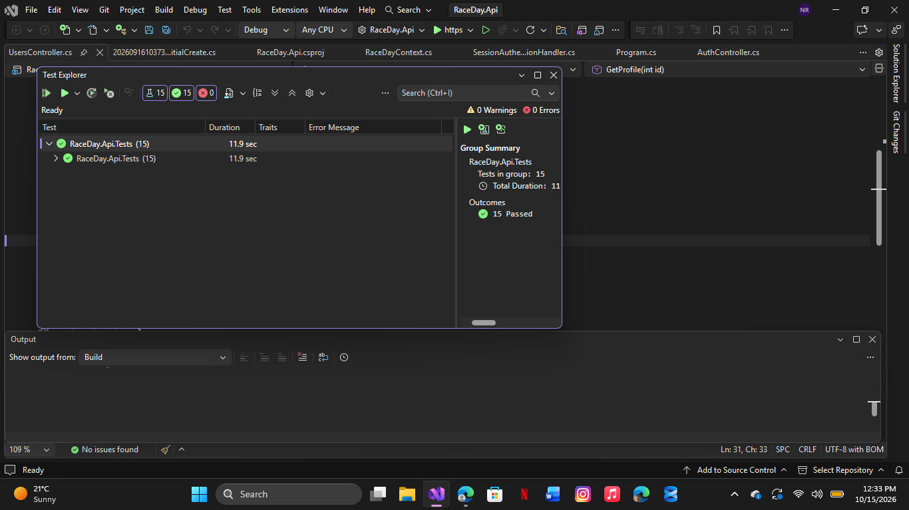
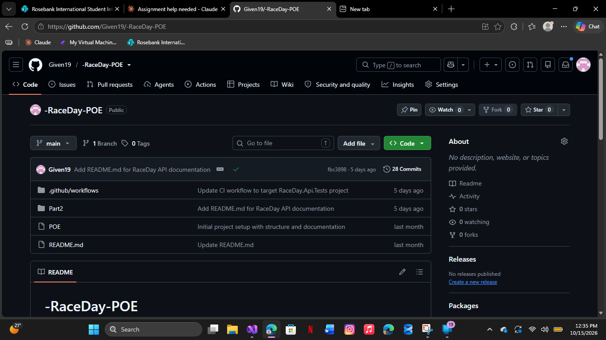
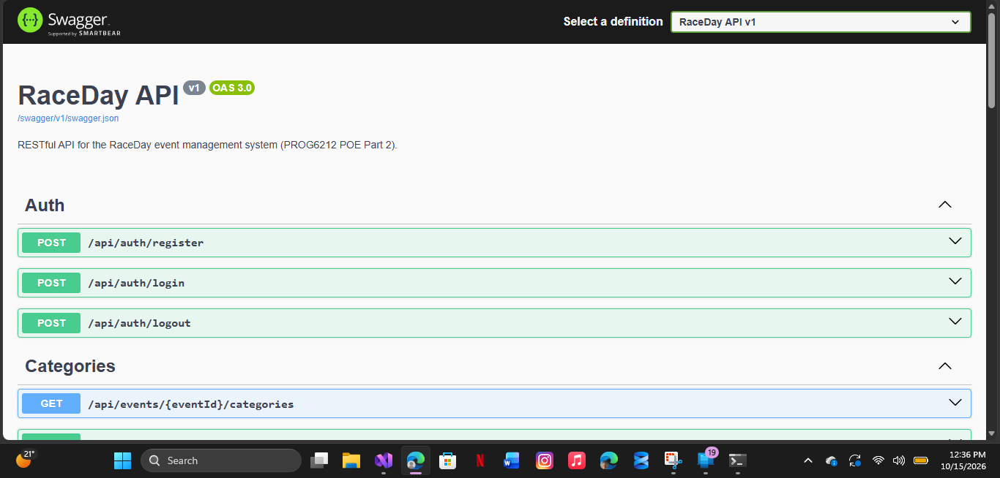

# RaceDay API – Part 2 (RESTful API Development)

PROG6212 Portfolio of Evidence. This folder holds the ASP.NET Core Web API that powers RaceDay, an event management system for South African road running, walking and cycling events. It implements the endpoint plan and database design from Part 1.

## The two roles

| Role | What they can do |
|------|------------------|
| **Organiser** | Create, update and delete their own events. Define categories for their events (for example Under 20, Senior, 10km, 21km). View all enrolments for their events. Capture finish times and positions. |
| **Participant** | Browse events and categories. Enter an event by choosing a category. View and cancel their own enrolments and see their own results. |
| **Both roles** | Register, log in and log out. View and update their own profile. |

Role rules are enforced on the server. An Organiser cannot use Participant-only endpoints (such as enrolling), and a Participant cannot use Organiser-only endpoints (such as creating events). Organisers can only change events and categories that they own.

## Tech stack
- ASP.NET Core Web API (.NET 8, C#)
- Entity Framework Core 8 (Code-First) with SQL Server
- Server-side session authentication
- Swagger (Swashbuckle) for live documentation and testing
- xUnit tests with an in-memory database
- GitHub Actions for CI

## Authentication
- Passwords are hashed with PBKDF2 (random salt, 100,000 iterations). They are never stored in plain text.
- On login, the user ID and role are stored in a **server-side session**. The cookie holds only a session ID.
- Each request is authenticated from that session, and `[Authorize(Roles = "...")]` enforces the role on protected endpoints.
- Unauthenticated requests receive `401`. A logged-in user with the wrong role receives `403`.

## Endpoints

| Area | Method and route | Access |
|------|------------------|--------|
| Auth | `POST /api/auth/register` | Public |
| Auth | `POST /api/auth/login` | Public |
| Auth | `POST /api/auth/logout` | Logged in |
| Profile | `GET /api/users/{id}` | Own profile only |
| Profile | `PUT /api/users/{id}` | Own profile only |
| Events | `GET /api/events` | Public |
| Events | `GET /api/events/{id}` | Public |
| Events | `POST /api/events` | Organiser |
| Events | `PUT /api/events/{id}` | Organiser (owner) |
| Events | `DELETE /api/events/{id}` | Organiser (owner) |
| Events | `GET /api/events/{eventId}/enrolments` | Organiser (owner) |
| Categories | `GET /api/events/{eventId}/categories` | Public |
| Categories | `POST /api/events/{eventId}/categories` | Organiser (owner) |
| Categories | `PUT /api/categories/{id}` | Organiser (owner) |
| Categories | `DELETE /api/categories/{id}` | Organiser (owner) |
| Enrolments | `POST /api/categories/{categoryId}/enrolments` | Participant |
| Enrolments | `GET /api/users/{id}/enrolments` | Own enrolments only |
| Enrolments | `DELETE /api/enrolments/{id}` | Participant (owner) |
| Results | `POST /api/enrolments/{enrolmentId}/result` | Organiser (owner) |
| Results | `GET /api/events/{eventId}/results` | Public |

All endpoints can be viewed and tried out in Swagger at `/swagger`.

## Setup and run

**Requirements:** .NET 8 SDK, SQL Server LocalDB (installed with Visual Studio) and Visual Studio 2022 or later.

1. Clone the repository.
2. Check the connection string in `Part2/RaceDay.Api/appsettings.json`. The default targets LocalDB:
   `Server=(localdb)\MSSQLLocalDB;Database=RaceDayDB;Trusted_Connection=True;TrustServerCertificate=True;`
3. Create the database from the EF Core migration. In Visual Studio, open **Tools → NuGet Package Manager → Package Manager Console**, set the default project to `RaceDay.Api` and run `Update-Database`.
4. Run the API:
```
   dotnet run --project Part2/RaceDay.Api
```
   Then open the URL shown in the console and add `/swagger`.
5. To try it out in Swagger: call `POST /api/auth/register`, then `POST /api/auth/login`, then call any protected endpoint. The browser keeps the session cookie automatically.

## Running the unit tests
```
dotnet test Part2/RaceDay.Api.Tests
```
There are 15 tests covering registration and login (success and failure), event management by Organisers, role rejection in both directions, unauthenticated access, ownership checks, and enrolments (including duplicate enrolment). The tests use an in-memory database and a test authentication handler, so they run the real authorization pipeline without needing SQL Server.



## CI/CD
The workflow `.github/workflows/part2-build-and-test.yml` restores, builds and runs all unit tests on every push.



## Swagger


## Differences from the Part 1 plan
- `Event` has two extra fields, `Distance` and `EventType` (Run, Walk or Cycle), because the Part 2 brief requires them.
- Table and column names match the Part 1 SQL script. The database is created by EF Core migrations (Code-First) instead of the Part 1 script.
- `RouteInfo` exists in the database as in the Part 1 ERD, but has no endpoints because Part 2 does not require them.
- Added `GET /api/events/{eventId}/enrolments` so Organisers can view all enrolments for their events, as the Part 2 brief requires.
- Participants view their own results through `GET /api/users/{id}/enrolments`, which includes each enrolment's result.

## Video walkthrough
[Watch the unlisted YouTube demo](https://youtu.be/u1dTjY3UYxo?si=KPftNqeUZut7Aukp)
